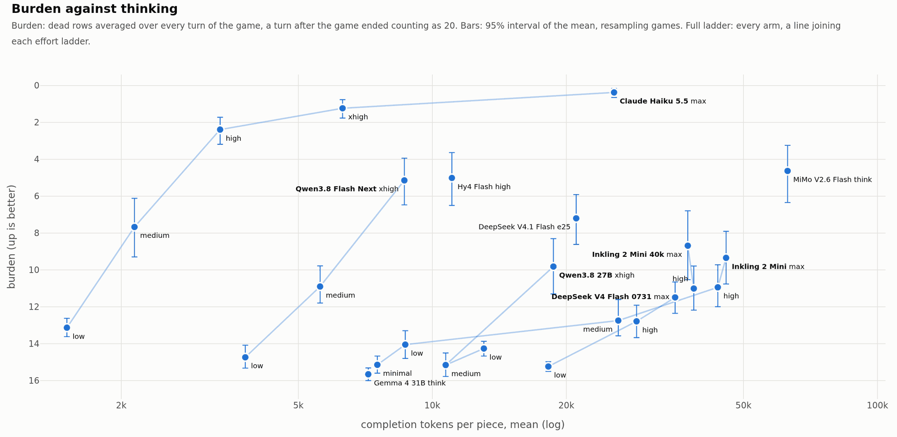

# topout-bench

LLMs playing NES Tetris® through tool calls, and a way to look closely at how they play.

Via [gym-tetris](https://github.com/Kautenja/gym-tetris), which provides the emulator and the game: this repository
contains no ROM. Not affiliated with or endorsed by The Tetris Company.

*Each dot is a model at one effort. Up is better play, left is less thinking. A snapshot: the data has moved on.*

## What it is

A model plays **tetris100**: 100 pieces, or until the stack tops out. It sees the board as text (`#` settled, `@`
falling, `.` empty), the current and next piece, lines and score. It plays by calling tools, one per button:
`start() left() right() rotate() drop() wait()`. The game waits while the model thinks, but every button costs game time
(12 frames, 200 ms, by default): thinking is free, moving is not. Each piece is one conversation, so the model keeps its
thinking for that piece while it steers it, and starts fresh on the next.

It works with any OpenAI-compatible chat completions endpoint that parses tool calls (vLLM, SGLang, llama-server,
hosted APIs).

| | |
|---|---|
| `topout-play.py` | plays games and writes a journal of everything that happened |
| `topout-explore.py` | the Explorer: every arm, game, piece and decision, interactive |
| `topout-plot.py` | the Explorer's figures as images or pages, and their numbers as tables |
| `topout-video.py` | the games as played, replayed through the emulator |
| `topout-publish.py` | puts finished games into a results dataset |

## Quick start

You need [uv](https://docs.astral.sh/uv/) and Python 3.13 or later. To look at our games without running any:

    git clone https://github.com/the-crypt-keeper/topout-bench && cd topout-bench
    uv sync
    uv run hf download mike-ravkine/topout-bench-results --repo-type dataset --local-dir results
    uv run topout-explore.py --dataset results                                                       # http://127.0.0.1:8050

To play your own against a local engine, and see them beside ours:

    uv run topout-play.py --apibase http://localhost:8000/v1 --model NAME --output games/run1 \
        --sampler sampler.json --seed 1 --lag-frames 12 --context-length 32768 --games 16 --parallel 8
    uv run topout-explore.py --dataset results --arm mine=games/run1

## Documentation

- **[Running it](docs/run.md)**: playing, exploring, plotting, publishing, and the dataset's layout.
- **[Reading it](docs/read.md)**: what each view shows, what to look for, and what it does not say. Start here if a plot
  is in front of you.
- **[Why it is like this](docs/why.md)**: the measurements we tried, what failed and how we could tell, and why the tools
  have the shape they have.

## Tests

    uv run pytest          # about two minutes: it plays short games against a fake engine, no GPU

The tests hold the instruction text, the board text and the tools to a recorded game, so new games stay comparable with
old ones. MIT licensed.
