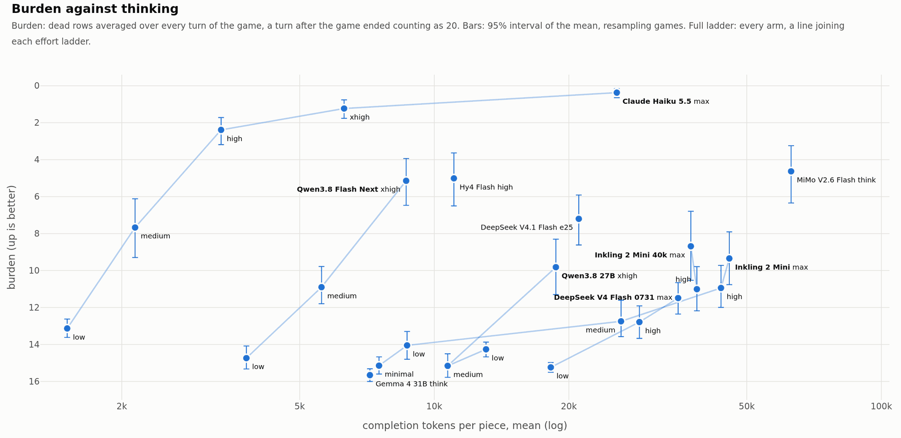
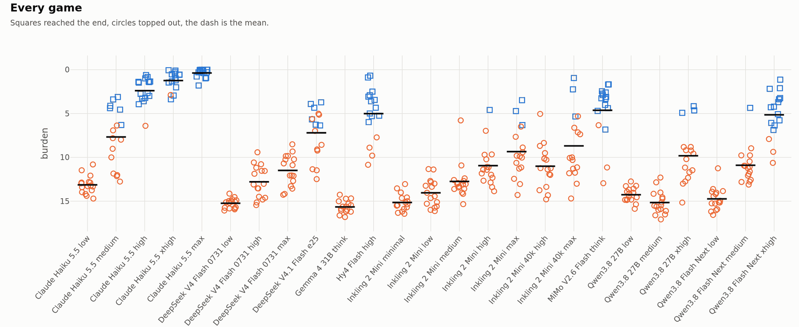
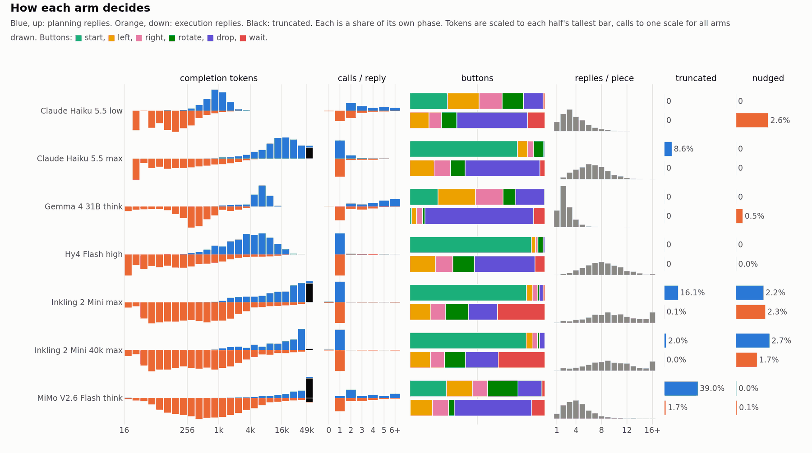
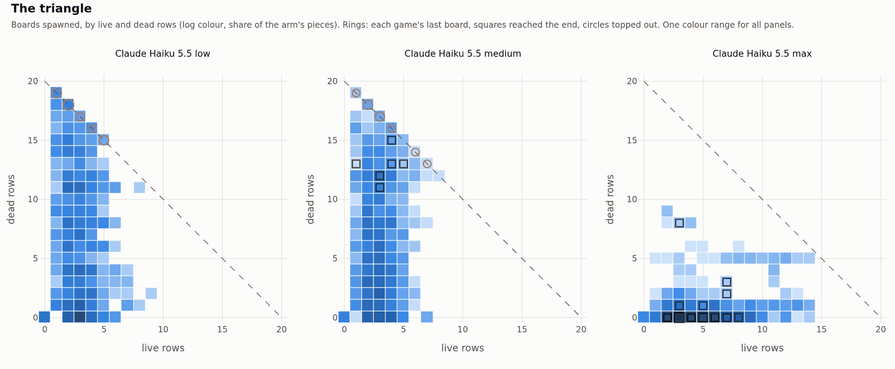
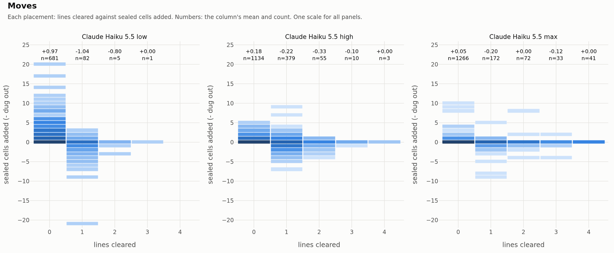
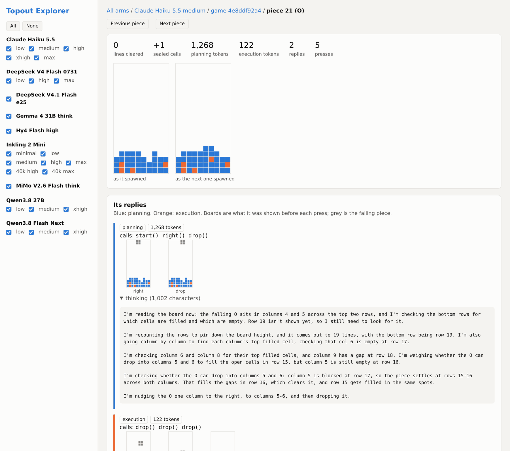
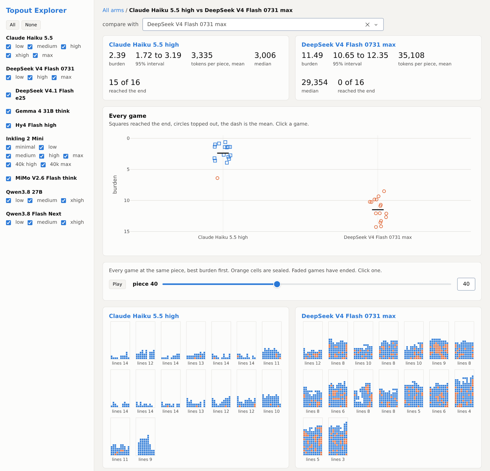

# Reading it

What each view shows, what to look for, and what it does not say. Examples are the public dataset in November 2026: 25
arms, 400 games, 26,846 pieces. Every figure is in the Explorer and in `topout-plot`.

- [Words](#words) · [A tour](#a-ten-minute-tour) · [Burden against thinking](#burden-against-thinking) ·
  [Every game](#every-game) · [Decisions](#decisions) · [The triangle](#the-triangle) · [Moves](#moves) ·
  [One game, one piece](#one-game-one-piece) · [Comparing](#comparing-arms) · [Not measured](#what-none-of-it-says)

## Words

| word | meaning |
|---|---|
| **arm** | games played the same way: one model, one sampler, one effort. 16 games in ours |
| **ladder** | a model's arms in effort order. One model can have two (Inkling with and without a token budget) |
| **piece** | one tetromino, one conversation. A game is up to 100 |
| **planning reply** | a piece's first reply (or a retry of it, or the first after a restart). This is where the thinking is |
| **execution reply** | every later reply for that piece: mostly pressing buttons |
| **sealed cell** | an empty cell nothing can reach until what covers it clears. Drawn orange on boards |
| **dead row** | a row holding a sealed cell. It cannot complete until dug out |
| **live row** | any other row of the stack: still completable |
| **burden** | dead rows averaged over all 100 turns of a game. A turn after the game ended counts as 20. 0 is perfect, 20 is worst |
| **truncated** | a reply cut off by its token limit. It is tried again, and every attempt counts |
| **nudged** | a reply with no tool call; `wait` was pressed for it |
| **reached the end** | all 100 pieces placed. Otherwise the game **topped out** |

## A ten minute tour

    uv run topout-explore.py --dataset results

1. **All arms.** Find Claude Haiku 5.5's ladder on the burden plot, and follow it up and right. Switch to **cost
   frontier**, then **best performance**: Haiku's dot moves from high to max, and Inkling's from low to 40k max. Every other
   model's stays put.
2. Click **Claude Haiku 5.5 medium**. Press **Play**. Sixteen games start alike and fan out: some stay low, some fill up
   with orange. Watch the triangle climb with them.
3. In **compare with**, add Claude Haiku 5.5 max. Same scrubber, same colours. One keeps to the bottom edge.
4. Go back, click one of medium's worse games, and find the piece where the orange bars step up. Click it.
5. Read what the model was thinking, and look at the board it was shown before each button.

## Burden against thinking

One dot per arm. **Up is better** (the axis runs from 0 at the top), **left is cheaper**. Both tokens options are per piece,
for the piece's whole conversation: the *mean* counts the long tail (what it costs), the *median* does not. Bars are the 95%
interval of the mean over the arm's games.

- **full ladder** joins each ladder's arms in effort order. A line that doubles back (Qwen3.8 27B) means an effort setting
  that costs less *and* plays worse than the one below it.
- **best performance** shows each model's lowest burden.
- **cost frontier** shows each model's arm nearest the top left corner: no burden, at the fewest tokens of any arm. Both
  axes are scaled 0 to 1 over every arm loaded, tokens in log, and weigh alike. It is a compromise, not the set of arms
  nothing beats: for Inkling it picks *low*, which plays badly and cheaply.

The rail chooses which arms are drawn. It never moves the axes or the corner.

**Look for** slope: how much better play each doubling of tokens buys. **Remember** that burden changes character down the
axis. At the top it is damage on boards that were played; at the bottom (0 of 16 reaching the end) 60% to 85% of it is
turns the games never played.

## Every game

Each mark is one game's burden: **squares** reached the end, **circles** topped out, the dash is the arm's mean. This is the
comparison itself; the interval above is a summary of it.

**Look for** shape, not only position. Haiku medium is spread from 3 to 13: the same policy sometimes holds together and
sometimes does not. MiMo has two bad games (11 and 13) and fourteen under 7, so its mean, 4.6, sits above eleven of its sixteen. Reaching the end is
not the same as playing well: some top-outs carry less burden than some survivors.

## Decisions

A fingerprint per arm. **Blue, up, is planning. Orange, down, is execution.** They are different populations and are never
added together; each is a share of its own phase.

| column | reading |
|---|---|
| completion tokens | log scale, 16 to 65k. Each half is scaled to its own tallest bar, so compare *shapes and positions*, not heights. Black is truncated |
| calls / reply | tool calls per reply, 0 to 6+. 0 is a nudge. Each half is on one scale for all the arms drawn |
| buttons | two strips: planning over execution |
| replies / piece | both phases together: it is a property of the piece |
| truncated, nudged | shares of that phase's replies, planning over execution |

What to look for, with examples above:

- **Where effort goes.** Along a ladder the blue hump slides right. Whether the orange one follows says if the model
  re-plans while steering (DeepSeek, Inkling, MiMo: one execution reply in ten runs past 1,000 to 6,000 tokens) or mostly executes (Haiku up to xhigh, Flash
  Next: under 1,000).
- **Two ways to start.** Hy4, Inkling and Haiku max answer the paused board with a lone `start` (a planning strip that is
  nearly all green) and steer afterwards. Gemma sends the whole plan in one reply, then mostly `drop`s.
- **One button at a time or bundled.** A single tall bar at 1 call, or a spread to 6+.
- **Waiting.** 29% to 35% of Inkling's execution presses are `wait`, at every effort. The next highest arm is 20%, and most
  are under 13%.
- **The cap.** Our games cap a reply at 49,152 tokens. A black bar there is the cap shaping the arm: 39% of MiMo's planning
  replies. Compare Inkling max with 40k max: the tail moves in from the cap and little else changes.

## The triangle

Every board a piece spawned into is a point: live rows across, dead rows up. The rest of the 20 rows are empty, so the
dashed line is a full board. Colour is the share of the arm's pieces, in log, on one range for all panels. Rings are each
game's last board (squares reached the end, circles topped out).

**A dense bottom left corner is a good player.** How the rest smears is the style:

- **Up** (a stripe at 2 to 4 live rows): play buries holes and they accumulate. A top-out's last board always sits on
  the dashed line, because the piece that could not be placed counts as part of it ([why](why.md#the-triangle-and-moves)).
- **Along the floor**: lots of completable rows and no damage, as when saving for a four line clear, or building towers.
- **Both**: less consistent play.

There is **no time** in the picture, on purpose. Its unit is the piece, so an arm with longer games simply has more of
them. The Explorer's scrubber adds time as motion: the cells fill in as you move it, and rings show the games still going.

Consecutive boards in a game differ by one piece, so the cells are not independent samples. Read the shape; do not put much
on a faint cell.

## Moves

Every placement: lines cleared across, sealed cells added up (below zero is dug out). Colour is its share of the arm's
placements, log, one range for all panels. The numbers are each column's mean change in sealed cells, and its count.

- **The 0 column's upper tail** is the damage. Is it erosion (many +1s) or catastrophe (a few +15s)?
- **Below zero** is digging out, which only a clear can do.
- **Columns 2, 3 and 4** show a player saving its clears. Haiku max clears less often than high (172 singles against 379)
  but makes 41 four line clears to high's 3.

## One game, one piece

A **game** page plots its tokens per piece (planning and execution), where it was truncated or nudged, dead and live rows
on each board, and every board. This is the one place piece number is an axis: it is one game's history, not a comparison.

A **piece** page shows the board before and after, and each reply: its phase, tokens, calls, the board shown before each
press, and the model's thinking. Haiku's thinking is followed in its journals by an encoded block that the app leaves out.

## Comparing arms

Up to four arms side by side share one scrubber, one triangle range, one moves scale and one set of fingerprint scales.

- Intervals that do not overlap rule out equal means. **Intervals that overlap say nothing.** Look at the two sets of games.
- 16 games is 16 samples of burden, whatever the number of pieces.
- Games are not paired: the deal depends on the play.
- Effort names are not comparable between models. Tokens are.

## What none of it says

- **Nothing here isolates skill from situation.** A strong player's boards are easy because it kept them easy. Comparing what
  two arms do *from the same board* is the open problem ([why](why.md#open)).
- **An arm is a served model.** Quantisation, engine, chat template, parser and token cap are all in it. A `think` arm on
  one engine is not the model's final word.
- **One seed, one lag, one prompt.** All our games share them.
- **The last piece has no outcome** beyond the lines it cleared: the journal holds boards before presses, so there is no
  board after it.
- **"Sealed" is generous to the player.** It assumes a 1x1 piece could squeeze anywhere, so a pocket no tetromino fits still
  counts as open.
